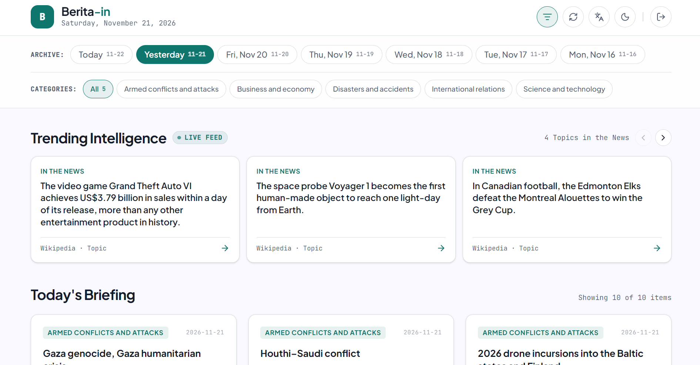
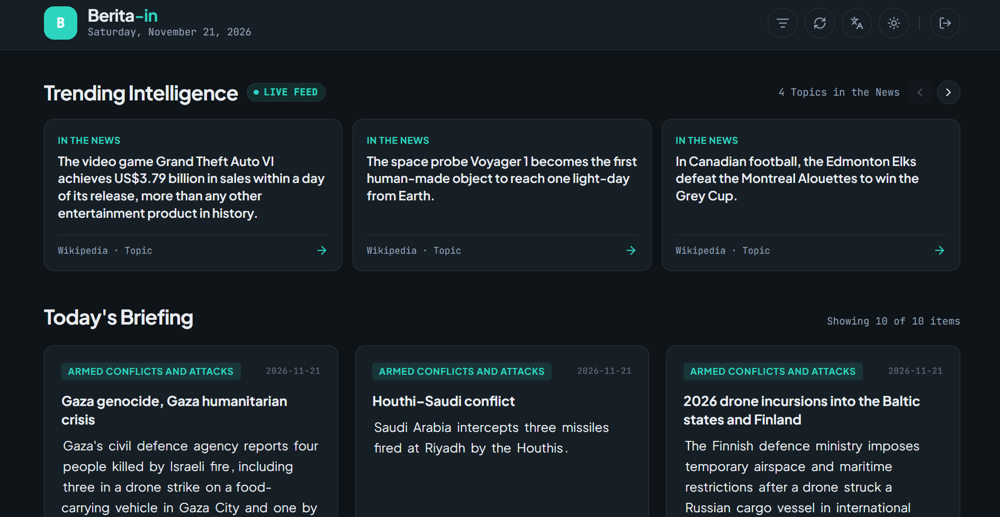
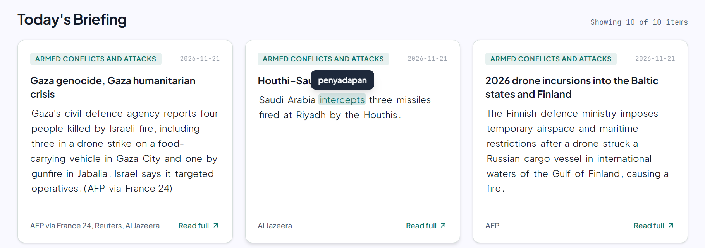

# Berita-in

Web *daily briefing* berita harian minimalis berbasis **Wikipedia Current Events** dengan fitur utama **terjemahan per kata (EN → ID)** untuk latihan bahasa Inggris.

---

## Pratinjau Aplikasi

| Mode Gelap (*Dark Mode*) | Fitur *Click-to-Translate* |
| :---: | :---: |
|  |  |

---

## Tentang Proyek

**Berita-in** adalah pembaca ringkasan berita harian (*daily briefing*) bebas gangguan yang mengambil data langsung dari **Wikipedia Current Events** (`Portal:Current events`). Aplikasi ini dibuat agar membaca berita internasional berbahasa Inggris setiap hari terasa ringan, rapi, sekaligus menjadi sarana belajar kosakata secara kontekstual.

---

## Fitur Utama

### 1. Terjemahan Per Kata Interaktif (EN → ID) *(Fitur Utama)*
* **Klik / Tap Kata untuk Arti Singkat:** Setiap kata bahasa Inggris pada ringkasan berita bisa diklik atau disentuh untuk memunculkan *pop-up* arti singkat dalam Bahasa Indonesia tanpa mengganggu kenyamanan membaca paragraf utuh.
* **Cepat dengan *Cache*:** Hasil terjemahan kata disimpan sementara di *cache* klien maupun server, jadi kata yang pernah dicari langsung muncul secara instan.

### 2. Terjemahkan Semua (EN ↔ ID) / *Translate All*
* **Satu Klik Ubah Bahasa Halaman:** Tersedia tombol *toggle* untuk menerjemahkan seluruh judul *Trending Intelligence*, tajuk topik, dan ringkasan *Today's Briefing* ke Bahasa Indonesia secara serentak, lalu kembali ke Bahasa Inggris kapan saja.

### 3. Kurasi Berita Wikipedia Current Events
* **Trending Intelligence (*Topics in the news*):** Menampilkan sorotan topik utama yang sedang hangat dalam tampilan kartu ringkas dengan navigasi geser halaman.
* **Today's Briefing & Arsip 7 Hari:** Menyajikan ringkasan berita harian yang dikelompokkan per kategori (politik, ekonomi, sains & teknologi, konflik, dan peristiwa dunia) lengkap dengan akses arsip hingga **7 hari ke belakang**.

### 4. Personalisasi Tampilan
* **Mode Terang & Mode Gelap (*Light / Dark Mode*):** Pengalih tema yang nyaman di mata untuk membaca pagi maupun malam, tersimpan otomatis di `localStorage` perangkat.
* **Filter Kategori:** Menampilkan atau menyembunyikan kategori berita sesuai minat bacaan dan menyimpannya langsung di peramban masing-masing perangkat.

### 5. Akses Privat & *Smart Caching*
* **Gerbang Akses Privat:** Dilindungi halaman masuk (*password gate*) dengan sesi *cookie* selama **30 hari**.
* ***Server Cache* & *Manual Refresh*:** Data Wikipedia di-*cache* secara berkala di server agar pemuatan halaman tetap cepat, disertai tombol *refresh* manual untuk mengambil pembaruan terbaru.

---

## *Tech Stack*

* **Framework:** Next.js (App Router) & TypeScript
* **Styling:** Tailwind CSS
* **Sumber Data:** Wikipedia MediaWiki API (`Portal:Current events`) & Cheerio HTML Parser
* **Hosting & Deployment:** Vercel

---

## Catatan

Konten berita bersumber dari komunitas penyunting **Wikipedia Current Events** dan ditautkan langsung ke referensi berita aslinya.
